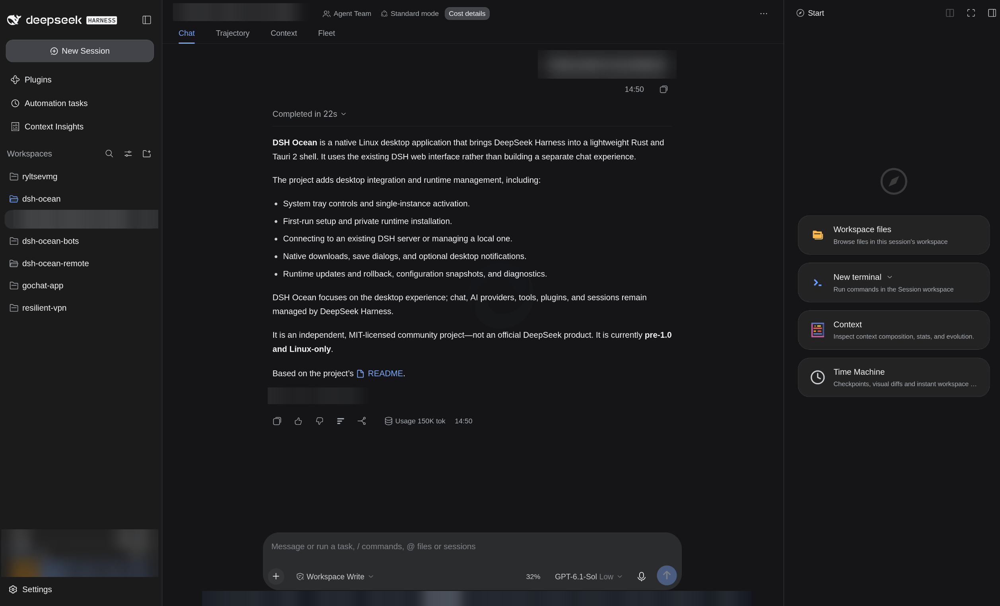

# DSH Ocean

[](https://github.com/ryltsevmikhail/dsh-ocean/actions/workflows/ci.yml)
[](LICENSE)

<p align="center"></p>

**A native Linux desktop home for DeepSeek Harness.**

This is the first public source snapshot of a previously private project. It starts
with a new Git history; earlier development is not presented as public commits.

DSH Ocean wraps the [DeepSeek Harness](https://github.com/deepseek-ai/deepseek-harness)
web interface in a small Rust/Tauri 2 shell. It adds a tray, runtime discovery,
first-run setup, server lifecycle management, native downloads and diagnostics—
without building a second chat interface.

<p align="center"></p>

**Independent community project; not an official DeepSeek product or endorsement.**
Ocean and the upstream runtime have separate release cycles and licenses. DeepSeek
names and marks belong to their respective owners.

> **Status: pre-1.0 / Linux only.** Build from source unless you have independently
> verified a release artifact. There is no production signed Ocean update feed or
> automatic shell updater. Configuration backups are not full data backups.

## What it does

- **Use an existing server or start one:** attach to local DSH, use a generated
  `systemd --user` service, or fall back to an owned child on a temporary loopback port.
- **Set up a private runtime:** explicitly install Node.js, DSH and pnpm under
  `~/.local/share/dsh-ocean`, without replacing system Node.js.
- **Integrate with the desktop:** tray controls, single-instance activation, zoom,
  native save dialogs and optional desktop notifications.
- **Keep credentials scoped:** exchange the launch token for the server's HttpOnly
  session cookie and restrict main-window navigation to the attached origin.
- **Maintain with explicit limits:** generation-based runtime update/rollback,
  configuration snapshots, diagnostics and read-only shell update guidance.

The actual chat, providers, tools, plugins and sessions belong to DSH. Ocean shares
its profile data; it is not a sandbox for actions the runtime performs.

## Build and install

### Requirements

- Linux with GTK 3, WebKitGTK **4.1** and Ayatana AppIndicator.
- Rust **1.90+**, a C/C++ build toolchain, OpenSSL development headers and `pkg-config`.
- Python **3.11+** for packaging/test helpers; Node.js for JavaScript tests and the
  upstream runtime. The compiled shell itself does not need Python.

On Ubuntu 24.04, install native build dependencies:

```bash
sudo apt-get update
sudo apt-get install -y build-essential pkg-config libssl-dev \
  libgtk-3-dev libwebkit2gtk-4.1-dev libayatana-appindicator3-dev \
  librsvg2-dev libxdo-dev patchelf
```

Install Rust through a distribution package or [rustup](https://rustup.rs/) you
trust, then build as your normal user:

```bash
git clone https://github.com/ryltsevmikhail/dsh-ocean.git
cd dsh-ocean
cargo build --release --locked
scripts/install.sh --no-build
```

Launch **DSH Ocean** from your desktop menu or run `~/.local/bin/dsh-ocean`.
Review installer behavior before reusing an existing installation; do not use sudo
for the per-user installer.

### Packages and platform coverage

Local tar, Debian and AppDir build helpers are available; see [packaging](docs/PACKAGING.md)
and [portable installation](docs/INSTALLATION.md). Artifacts are not a promise of
ABI portability or publisher authenticity. The Arch `PKGBUILD` is a **developer
packaging template**, not a published AUR package or a working clone-and-install
recipe: it needs a prepared source archive and currently uses `SKIP` checksums.
AppImage requires an independently trusted tool digest; real image/container and
manual launch acceptance remain pending.

CI checks the declared MSRV and stable Rust on **Ubuntu 24.04 x86_64**, including
native GTK/WebKit tests under Xvfb. Linux aarch64 has local build/test evidence,
not a complete supported-distro matrix. Windows and macOS are not supported.
“All Cargo targets” in CI means library/binary/test targets, not every architecture.

## First launch

1. Ocean discovers an installed/private DSH runtime and probes the configured server
   (loopback `127.0.0.1:3080` by default).
2. If needed, setup offers an explicit runtime download. If systemd is usable,
   Ocean can create and enable `dsh-web.service`; otherwise it starts a managed child.
3. It authenticates and opens the upstream web interface.

**The user service can keep running after the window closes and start at login.**
Closing to the tray is not the same as quitting. To disable service autostart:

```bash
systemctl --user disable dsh-web.service
```

This does not stop a currently running server. Do not stop the server from a chat
session that depends on it. See [usage and maintenance](docs/USAGE.md) for runtime
selection, rollback, backups, LAN pairing and CLI commands.

## Security and privacy

Read the [security policy](SECURITY.md) before exposing a server or sharing logs.

- Loopback is the default. Authenticated launch URLs and pairing QR codes grant
  bearer access. LAN exposure is manual; the native probe does not support HTTPS.
  Do not expose it directly on an untrusted network.
- Ocean does not install Tauri filesystem/shell/HTTP capability plugins for remote
  pages. Its navigation fence is not protection from a compromised attached DSH
  server. The Tauri CSP is currently unset; do not infer a CSP-based isolation guarantee.
- Known launch-token patterns are redacted from diagnostics, but paths, journal
  content and other private data may remain. Inspect output before posting it.
- The shell does not implement telemetry collection. DSH, providers, plugins and
  package/download services have their own network behavior and privacy policies.
- Runtime rollback does **not** undo profile/session data migrations. Keep separate
  backups. In-process preparation, restart, recovery and update use an exclusive
  admission gate; overlapping requests are refused as busy, not queued. This does
  not coordinate separate CLI processes or undo an external worker's side effects.

Report suspected vulnerabilities privately using [SECURITY.md](SECURITY.md), not
an ordinary issue. This volunteer project does not promise a security-response SLA.

## Documentation

| Topic | Guide |
|---|---|
| Everyday use, runtime maintenance, pairing | [Usage](docs/USAGE.md) |
| Data and configuration backup limits | [Profile backups](docs/PROFILE_BACKUPS.md) |
| Native transfers and cancellation | [Downloads](docs/DOWNLOADS.md) |
| Desktop notifications | [Notifications](docs/NOTIFICATIONS.md) |
| Architecture and trust boundaries | [Architecture](docs/ARCHITECTURE.md) |
| Isolated tests and acceptance evidence | [Update testing](docs/UPDATE_TESTING.md) |
| Packaging, release process and verification | [Documentation index](docs/README.md) |
| Development direction | [Roadmap](docs/ROADMAP.md) · [Changelog](CHANGELOG.md) |

The Xvfb recovery scenario exercises **real Ocean/WebKit with a controlled HTTP
child**, not full real-DSH HTML/provider behavior. Real-runtime helper tests are
separate and opt-in. Green CI is not a complete security or compatibility audit.

## Contributing and support

Read [CONTRIBUTING.md](CONTRIBUTING.md) for build/test commands and review expectations.
Small bug fixes, regression tests and clear documentation are welcome. For help,
follow [SUPPORT.md](SUPPORT.md) and search [issues](https://github.com/ryltsevmikhail/dsh-ocean/issues).

Participation follows the [code of conduct](CODE_OF_CONDUCT.md). Scope, review and
release decisions are described in [governance](GOVERNANCE.md).

## License and attribution

Original Ocean code is [MIT licensed](LICENSE). Third-party components retain their
own licenses; the root license does not relicense them. The original
[Ocean Ice identity](docs/BRANDING.md) replaces upstream-derived artwork.
Component boundaries are described in [NOTICE](NOTICE). Copyright permission is
not a trademark license or an endorsement. Dependency/asset provenance must be reviewed before
redistributing binaries; see [packaging limitations](docs/PACKAGING.md).
